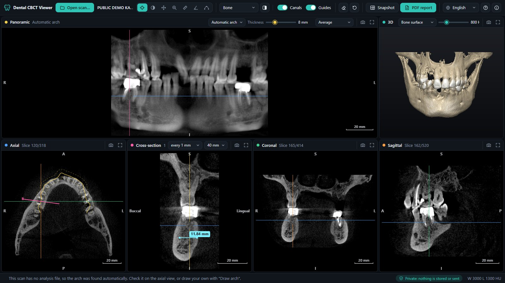
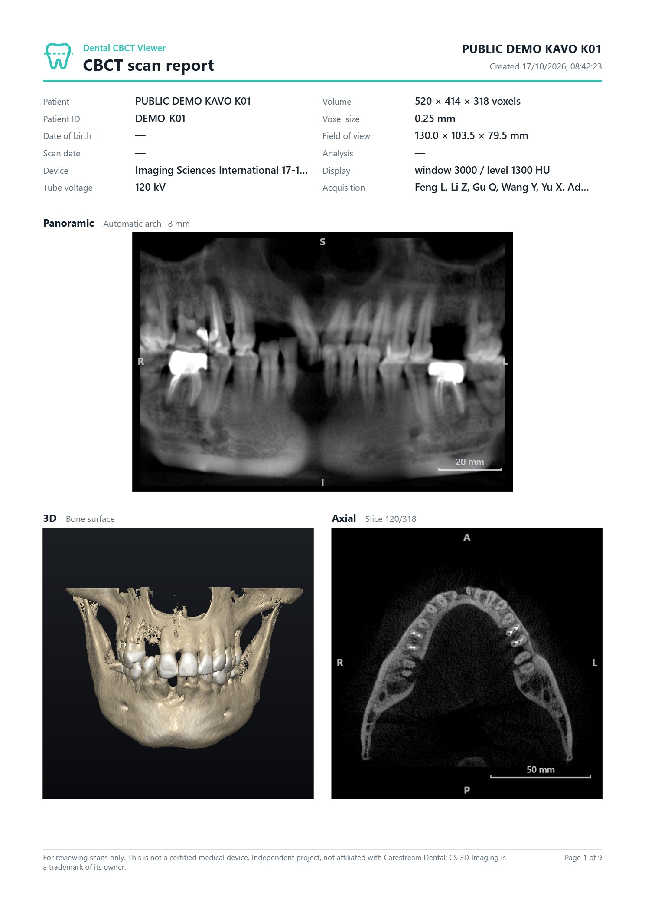
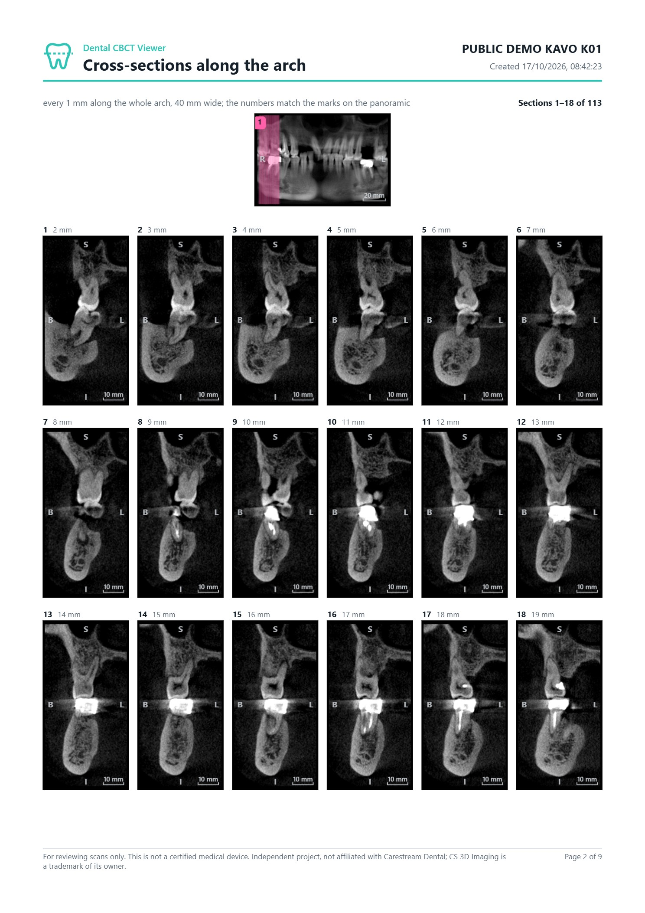

# Dental CBCT Viewer

[](https://github.com/kitsorfan/dental-cbct-viewer/actions/workflows/ci.yml)
[](LICENSE)

A dental CBCT viewer that runs entirely in the browser. Open a scan folder or its ZIP file and get a panoramic reconstruction, cross-sections along the arch, axial/coronal/sagittal slices, a 3D rendering, measurements and a one-click PDF report with serial cross-sections every millimetre. It works on computers, tablets and phones. Nothing to install, nothing stored, and the scan never leaves your device.

**[Open the viewer](https://kitsorfan.github.io/dental-cbct-viewer/)** · **[Download for offline use](https://github.com/kitsorfan/dental-cbct-viewer/releases/latest/download/dental-cbct-viewer.html)** · **[Privacy, live](https://kitsorfan.github.io/dental-cbct-viewer/#privacy)**

Try it with **[the synthetic demo jaw](https://kitsorfan.github.io/dental-cbct-viewer/?demo)** (opens instantly) or **[a real public scan](https://github.com/kitsorfan/dental-cbct-viewer/releases/download/demo-data/dental-cbct-demo-kavo.zip)** (91 MB; open the ZIP as it is).

English · Ελληνικά · Français



<sub>Images: anonymized public CBCT (case K01) by Feng L, Li Z, Gu Q, Wang Y and Yu X, [Science Data Bank](https://doi.org/10.57760/sciencedb.26465), CC BY 4.0, cropped and de-identified for this demo. The arch was found automatically.</sub>

## Using it

1. Open the viewer online, or the downloaded `dental-cbct-viewer.html`, which also works offline from a USB stick or a shared folder.
2. Drag the scan folder or its ZIP file onto the window, or click **Open scan…** and pick it. The patient's folder, the `Data` folder of an export or the root of a CD all work. On a phone, pick the ZIP file as it is; there is no need to unzip it.
3. Click the panoramic to see the cross-section at that point. **PDF report** creates the whole document in one click.

The **?** button opens the user guide; the **ⓘ** button opens About, Privacy and Terms.

| | |
|---|---|
| Mouse wheel | Scroll slices · move the panoramic curve buccal/lingual · step the cross-section along the arch (1 mm by default) |
| Click the panoramic | Show the cross-section at that point |
| Right drag | Brightness / contrast (window/level) |
| Ctrl + wheel, middle drag | Zoom, pan |
| Double-click, **F** or ⤢ | Expand a view to fill the window |
| **S** or the camera icon | Save a view as PNG |
| **Delete**, **Ctrl+Z** | Remove the newest measurement in the view under the pointer; undo |

On a phone or tablet:

| | |
|---|---|
| Tap or drag | The selected tool; tap the panoramic to show the cross-section there |
| Two fingers | Pinch to zoom, drag to pan (also rotates and zooms the 3D view) |
| Double-tap | Expand a view; finishes a drawn arch |
| **Scroll slices** tool | Drag up or down to step through slices, like the mouse wheel |
| Tabs at the bottom (phones) | Choose the view shown below the panoramic |

## Features

- **Dental views**: panoramic reconstruction along the arch (adjustable slab thickness, average or MIP), cross-sections perpendicular to the arch, linked axial/coronal/sagittal slices and a 3D view (bone surface, teeth surface, MIP, simulated X-ray).
- **Automatic arch**: scans without an analysis file get their dental arch found from the teeth, so the panoramic and cross-sections work as soon as the scan opens. You can also draw your own.
- **CS 3D Imaging analyses**: when an export includes one, the arches and the traced inferior alveolar nerve canals are loaded and drawn on every view.
- **Measurements**: distances in mm and angles, on any 2D view.
- **PDF report**, created automatically on A4:
  - scan details, panoramic with the nerve canals, 3D and axial views;
  - serial cross-sections along the whole arch, every 1 mm by default (0.5, 2 or 5 mm on request), numbered and matched to marks on the panoramic;
  - the current views with every measurement in a table.
- **Exports**: PNG of any view and a snapshot of the whole layout.
- **Phones and tablets**: layouts for phones (the panoramic plus one chosen view), tablets in portrait and landscape, touch gestures and finger-sized controls.
- **ZIP files** open directly, read in place by the browser without unpacking to disk, including ZIP64 archives.
- **Three languages**, picked from the browser or the toolbar: English, Greek and French.
- **Help centre** with a user guide, a live privacy check, About and Terms of use.

<p>
  
  
</p>

## Privacy and security

- **Nothing leaves your computer.** The viewer is a static page with no server side. Scans are read with the browser's file APIs and kept in memory; images and reports are created locally and go straight to your Downloads folder.
- **Nothing is stored.** No cookies, local storage, databases or analytics. The language choice lives only in the page address (`?lang=fr`).
- **The page is locked down.** A Content Security Policy lets only the viewer's own script run (pinned by its SHA-256 hash) and blocks every network connection, so even a bug could not send a scan anywhere.
- **See it live.** The Privacy tab (or the badge in the status bar) checks, while you watch, that no connections were made, that connection blocking is active, that nothing is saved in the browser, and what is in memory. It can also close the scan and erase it from memory.
- **Safe with any file.** Files are only read as image data and never executed. Implausible sizes, deep nesting, oversized or entity-declaring analysis files and malformed data are rejected with a clear message.

The online version is served by GitHub Pages, which, like any web host, sees that the page was requested; the offline file avoids even that. See [SECURITY.md](SECURITY.md) for details and how to report a problem privately.

## Supported scans

- DICOM CT series, one file per slice (with or without the `.dcm` extension) or a single multi-frame file.
- Uncompressed transfer syntaxes: implicit and explicit VR little endian; 8- or 16-bit, signed or unsigned.
- Character sets including UTF-8 and Greek (ISO 8859-7), so Greek patient names display correctly.
- Tested with Carestream CS 8100 3D exports (CS 3D Imaging) and KaVo exports from the public [missing-teeth CBCT dataset](https://doi.org/10.57760/sciencedb.26465) (CC BY 4.0).

Compressed DICOM (JPEG, JPEG 2000, JPEG-LS, RLE) is not supported yet; the viewer says so when it meets one. Most CBCT software can export uncompressed DICOM.

## Development

The viewer is written in TypeScript and has no runtime dependencies. Node 24 or newer runs the dev server, the tests and the build directly from the `.ts` sources, using Node's built-in type stripping, so they need no packages. The TypeScript compiler is a development dependency used only to check the types (strict mode); install it with `npm ci`.

```sh
npm run dev        # serve the source at http://127.0.0.1:8080
npm test           # unit tests: DICOM parsing and limits, ZIP reading, reformatting, PDF writer, translations, build and CSP
npm run typecheck  # strict type checking of the browser code (tsconfig.json) and of the tests and scripts (tsconfig.node.json)
npm run build      # bundle everything into dist/index.html
```

Only erasable TypeScript is used (no enums or namespaces), since the types are stripped rather than compiled.

The tests generate their DICOM files in memory, so no patient data is needed or stored in the repository. `.gitignore` also blocks `.dcm` files, `DICOMDIR` and report PDFs.

| File | Purpose |
|---|---|
| `src/dicom.ts` | DICOM parsing with input limits, series grouping, volume assembly, CS 3D Imaging analysis files |
| `src/zip.ts` | Reads scans straight from ZIP archives (stored, deflated, ZIP64) without unpacking them |
| `src/reslice.ts` | Orthogonal, panoramic and cross-sectional reformatting |
| `src/autoarch.ts` | Finds the dental arch from the teeth when a scan has no analysis |
| `src/viewport.ts` | 2D view rendering, zoom/pan and input |
| `src/vr.ts` | WebGL2 ray-marched 3D rendering |
| `src/touch.ts` | Finger tracking shared by the views: pinch and double-tap |
| `src/report.ts`, `src/pdf.ts` | PDF report layout and a small PDF writer |
| `src/phantom.ts` | Synthetic demo scan |
| `src/i18n.ts` | English, Greek and French strings, including the guide, privacy and terms pages |
| `src/app.ts` | Application state, overlays, tools, help centre and exports |
| `scripts/build.ts` | Strips the types, inlines everything into one HTML file and pins the script hash in the CSP |

Pushing to `main` checks the types, runs the tests and deploys the built page to GitHub Pages. Pushing a `v*` tag attaches `dental-cbct-viewer.html` to a GitHub release.

## Disclaimer

This software is for reviewing scans only. It is not a certified medical device and must not be used as the sole basis for diagnosis or treatment planning; use certified software for clinical decisions. The full [terms of use](https://kitsorfan.github.io/dental-cbct-viewer/#terms) are in the app.

This project is independent and not affiliated with or endorsed by Carestream Dental. Carestream and CS 3D Imaging are trademarks of their respective owners and are named only to describe file compatibility.

## Credits

The real demo scan comes from *Adults' dental cone beam computed tomography images dataset for detecting and classifying missing teeth* by Feng L, Li Z, Gu Q, Wang Y and Yu X ([Science Data Bank](https://doi.org/10.57760/sciencedb.26465); [Scientific Data, 2026](https://doi.org/10.1038/s41597-026-07156-9)), licensed under [CC BY 4.0](https://creativecommons.org/licenses/by/4.0/). The authors report ethics approval and patient consent for sharing. For the demo it was cropped to the jaws, its dates and device identifiers were removed and it was given new DICOM UIDs; pixel values are unchanged.

## License

[MIT](LICENSE) © 2026 Kitsos Orfanopoulos
